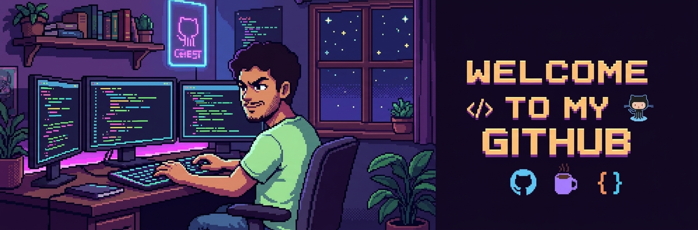

<p align="center">
  
</p>

```
                               I'm an Associate Software Engineer who loves building solutions,
                                 exploring ideas, and turning "what if?" into "what's next?"
```


<h3 align="center">🚀 Tech Stack</h3>

<table>
  <tr>
    <td width="50%" valign="top">
      <h3 align="center">💻 Languages</h3>
      <p align="center">
        
        
        
        
        
        
        
        
        
      </p>
    </td>
    <td width="50%" valign="top">
      <h3 align="center">🗄️ Databases & ORM</h3>
      <p align="center">
        
        
        
        
        
      </p>
    </td>
  </tr>
  <tr>
    <td width="50%" valign="top">
      <h3 align="center">🎨 Frontend & Mobile</h3>
      <p align="center">
        
        
        
        
        
        
        
        
        
        
        
        
      </p>
    </td>
    <td width="50%" valign="top">
      <h3 align="center">⚙️ Backend & APIs</h3>
      <p align="center">
        
        
        
        
        
        
        
        
        
        
      </p>
    </td>
  </tr>
  <tr>
    <td colspan="2" valign="top">
      <h3 align="center">🛠️ DevOps, OS & Tools</h3>
      <p align="center">
        
        
        
        
        
        
        
        
        
        
        
        
        
        
        
      </p>
    </td>
  </tr>
</table>

<h3 align="center">📊 GitHub Stats</h3>

<p align="center">
  
  
</p>

<br/>

